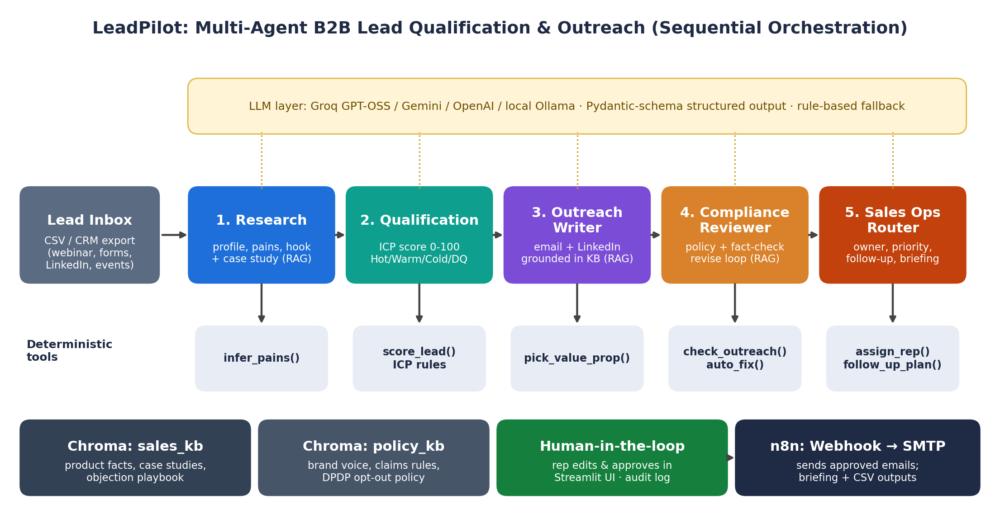

# LeadPilot: Multi-Agent B2B Lead Qualification & Personalised Outreach

End-term project, **Agentic AI for Business Automation**, FORE School of Management.
Hardik Srivastava (065077) · PGDM 2026–27 · Submitted to Prof. Shiva Botchu.

**The problem.** B2B sales teams collect leads from webinars, website forms, LinkedIn and events faster than they can work them. Each lead needs research, a fit decision, a personal email and logging. Done by hand that is slow and uneven, and good leads go cold.

**The solution.** Five AI agents prepare the outreach for every lead for *PayNest*, a fictional HR and payroll software company. A sales rep approves every email, and only then does an n8n workflow send it.



> All companies, people and leads in this repository are fictional. The time-saving figure assumes about 23 minutes of manual work per lead; it is an estimate, not a measurement.

## The agent team

| # | Agent | What it does | Tools and knowledge |
|---|-------|--------------|---------------------|
| 1 | Research | Profiles the account: pains, a personal hook and a same-industry case study; flags instruction-like text in lead fields | `infer_pains()`, `detect_injection()`, sales_kb |
| 2 | Qualification | Scores the lead out of 100 on five factors; tiers it Hot, Warm, Cold or Disqualified; explains why | `score_lead()` |
| 3 | Outreach Writer | Drafts an email and LinkedIn note for Hot and Warm leads, using only knowledge-base facts | `pick_value_prop()`, sales_kb |
| 4 | Compliance Reviewer | Checks banned phrases, length, name, company, call to action, opt-out line and every number; revises up to twice or sends to a person | `check_outreach()`, `auto_fix()`, policy_kb |
| 5 | Sales Ops Router | Assigns an owner by territory, priority and dated follow-ups; writes the manager's briefing | `assign_rep()`, `follow_up_plan()` |

**Design choices**
- *Decisions that matter are deterministic.* Scoring, policy checks, the fact check, injection detection and routing are plain Python, so the same lead always gets the same result. The language model only writes and explains.
- *Agentic RAG with two knowledge bases.* `sales_kb` (19 chunks) and `policy_kb` (5 chunks) live in Chroma; agents write their own queries and filter by industry.
- *Structured output.* Every model answer must match a Pydantic schema; invalid output gets one repair attempt, then the rule-based fallback.
- *Resilient.* Bad keys and retired models are reported, not retried; a circuit breaker stops after three failures; every run completes.
- *Human-in-the-loop.* Nothing is sent without a person's approval. Every agent action is logged.

## Run it

```bash
git clone <your-repo-url>
cd <repo-folder>
pip install -r requirements.txt
streamlit run app.py        # web app at http://localhost:8501
python run_cli.py           # or run from the terminal; results go to outputs/
```

**Demo mode** needs no key. For **live mode**, paste a free Groq key (console.groq.com/keys) in the sidebar and click *Test connection*. The default Groq model is `openai/gpt-oss-20b`; any model name can be entered in the sidebar. Gemini and OpenAI keys also work, and *ollama (local)* runs on your own machine (`ollama pull llama3.2`). To send approved emails, follow `n8n/README_n8n.md`.

## Tests and evaluation

```bash
python -m pytest -q                 # 82 tests
python scripts/evaluate.py final    # writes docs/EVALUATION_final.md and .json
```

Results from 10 October 2026 (demo mode):

| Measure | Result |
|---|---|
| Automated tests | 82 passed |
| Sample leads: tier and territory correct | 20/20 |
| Held-out leads (written after fixes): tier / territory | 8/8 / 7/8 |
| Red team: planted faults approved | 0 of 130 |
| Drafts with an unsupported figure | 0 of 13 |
| Retrieval, held-out wording: correct section first | 5 of 8 |

Round 1 found five defects (for example, "Bangalore" silently routed to the wrong rep), all fixed; see `docs/EVALUATION_round1.md`. The held-out miss (Secunderabad) fails safely to the sales manager and was left unfixed so the result stays honest.

## Files

| Path | Purpose |
|------|---------|
| `app.py` | Streamlit interface |
| `orchestrator.py` | Runs the five agents, keeps the log, computes metrics |
| `agents.py` | The five agent classes |
| `tools.py` | Scoring, checks, injection guard, routing |
| `rag.py` | Embeddings and the two Chroma knowledge bases |
| `llm.py` | Client for Groq, Gemini, OpenAI and Ollama |
| `schemas.py` | Pydantic output schemas |
| `config.py` | Seller, ICP, team, territories, aliases, policy limits. Edit to adapt to any business |
| `knowledge_base/` | Markdown sources for sales_kb and policy_kb |
| `data/sample_leads.csv` | 20 fictional sample leads |
| `data/eval/` | Expected outcomes, variants, held-out leads, retrieval queries |
| `scripts/evaluate.py` | Evaluation script |
| `tests/` | pytest suite (7 files) |
| `n8n/` | Webhook → Split Out → Send Email workflow and guide |
| `docs/` | Architecture diagram, screenshots, evaluation results |

## Security
Never commit an API key. Put it in a `.env` file (ignored by Git; see `.env.example`) or paste it into the sidebar. Keys are never logged or shown in error messages.

## License
MIT. See `LICENSE`.
